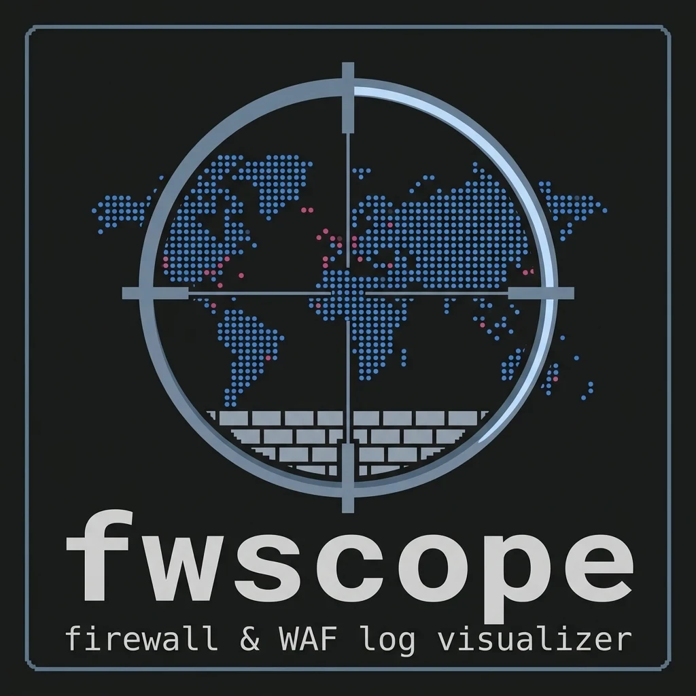
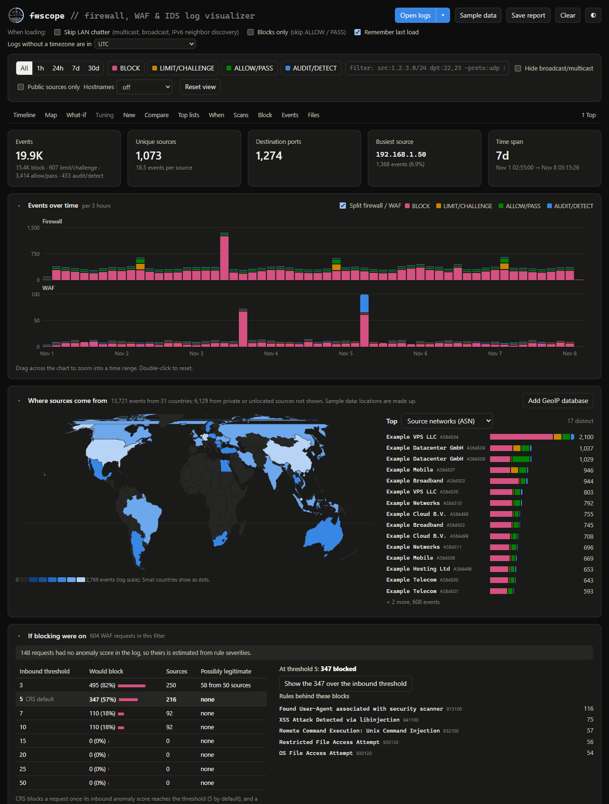

<p align="center"></p>

# fwscope

[](https://github.com/magikh0e/fwscope/actions/workflows/test.yml)

A single-file, offline visualizer for firewall and WAF logs: UFW, nftables / iptables / firewalld, OPNsense / pfSense, Windows Firewall, fail2ban, Suricata, ModSecurity / Coraza, and Cloudflare firewall events. Open `index.html` in a browser, drop your logs on it, and you get a dashboard. Everything is parsed in the browser tab. Nothing gets uploaded, and there are no dependencies or CDN calls, so it also works on an air-gapped box. The one exception is the optional hostname lookup, which is off unless you turn it on (see [Hostnames](#hostnames-reverse-dns)).



*The built-in sample data (made-up documentation addresses).*

**Try it in your browser:** [magikh0e.github.io/fwscope](https://magikh0e.github.io/fwscope/) opens the tool, and [`?demo`](https://magikh0e.github.io/fwscope/?demo) opens it on the sample data. Logs you drop there are read in your browser, just like the downloaded file. To use it offline, download `index.html` and open it from disk.

## What it reads

- `/var/log/ufw.log`, `kern.log`, `syslog`, including rotated `.gz` files (gzip is detected by magic bytes)
- `journalctl` text output (`short`, `short-iso`) and `journalctl -o json`
- `dmesg -T` (plain `dmesg` works too, but those lines have no wall-clock time, so they're left out of the time charts)
- Pasted lines

Lines that aren't firewall log lines are ignored, so you can feed it a whole `syslog`. Drop several files at once to merge them. You can also add files later: once logs are loaded, **Open logs** becomes **Add logs**, and dropping files on the dashboard adds them too. Each addition says how many new events it brought and how many duplicates were skipped. **Clear** starts over.

- **Folders:** drop a whole folder (subfolders too), or use **Folder** to pick one. Hidden files and things that can't be logs (images, archives other than `.gz`, binaries) are skipped.
- **Loaded files:** the card at the bottom of the dashboard lists each file with its events, duplicates and skipped lines. **Remove** takes one out by re-reading the others, so counts and duplicates come out as if it had never been loaded. Your view, filter and block ticks stay. UFW's default rsyslog config writes each line to `ufw.log`, `kern.log` *and* `syslog`, so a line that shows up again in a later file is skipped as a duplicate.

### Getting the logs

```bash
sudo cp /var/log/ufw.log* ~/ && sudo chown $USER ~/ufw.log*
journalctl -k -g 'UFW ' -o short-iso --since '-7d' > ufw-journal.log
journalctl -k -g 'UFW ' -o json > ufw.json
```

`sudo ufw logging medium` also logs allowed new connections (ALLOW). At `low`, you only see blocks and rate-limited hits.

### nftables, iptables and firewalld

Any kernel log line with `SRC=`, `DST=` and `PROTO=` is read the same way as a UFW line, whatever its log prefix: nftables `log prefix "nft-drop: "`, iptables `-j LOG --log-prefix "IPTables-Dropped: "`, or firewalld's `FINAL_REJECT:` and friends. The prefix becomes the action. Prefixes that say drop, reject, deny or block count as blocks; accept, allow or pass as allowed; limit as rate limited; anything else as logged (the AUDIT group).

```bash
journalctl -k -g 'SRC=' -o short-iso --since '-7d' > netfilter.log
```

firewalld logs refused packets after `firewall-cmd --set-log-denied=all`.

### fail2ban

fail2ban's own log (`/var/log/fail2ban.log`) shows what it found, banned and unbanned. Each line becomes an event: **F2B BAN** (blocks, including `Restore Ban` after a restart), **F2B FOUND** (a matched failure, in the AUDIT group) or **F2B UNBAN** (allowed group). The jail (`sshd`, `nginx-botsearch` …) shows as the rule, so the Rules list and `rule:sshd` work. Load it alongside the firewall or WAF logs to see which attackers fail2ban caught and which it missed:

- the **Scans** card marks each scanner or hammerer **fail2ban banned** or **not banned** (a missed one usually means no jail covers that service)
- **Block suggestions** say the same in their reasons
- the **Sources** list notes **banned by fail2ban**, and `seen:f2b` filters to the sources it banned (`-seen:f2b` to the rest)

## OPNsense / pfSense

It also reads `filterlog` lines, in any of these forms:

- OPNsense's local files, `/var/log/filter/filter_YYYYMMDD.log` (RFC 5424, `<134>1 2026-11-07T... host filterlog ...`)
- BSD syslog, as sent to a remote syslog server (`Nov  7 18:23:45 fw filterlog[123]: ...`)
- JSON from the API behind Firewall → Log Files → Live View (`/api/diagnostics/firewall/log`), either as an array or one object per line. This form includes the interface names (WAN, LAN) and rule descriptions.

Getting the files:

```bash
scp 'root@opnsense:/var/log/filter/filter_*.log' .
ssh root@opnsense 'cat /var/log/filter/filter_*.log' > opnsense-filter.log
```

How OPNsense data maps onto the dashboard:

- `pass` shows as PASS, under the ALLOW/PASS group. `block` and `reject` count as blocks.
- The logged interface becomes **In** or **Out**, depending on the packet's direction.
- The syslog hostname becomes **Host**, so you can merge a router and a server in one view.
- The matching rule becomes a **Rule** column, a "Firewall rules" Top list, and a `rule:` filter. A plain log only has the rule's 32-character ID, which the page shortens. To see which rule an ID belongs to, look it up in OPNsense under Firewall → Rules.

### Rule and interface names

Plain `filterlog` lines only carry IDs: interfaces as `vtnet0` / `igb1`, rules as a UUID (your own rules) or a 32-character hash (OPNsense's built-in rules). Drop either or both of these along with the logs, or on their own later, to see names instead:

- **Config backup**, from System → Configuration → Backups → Download. Gives interface names (LAN, WAN1, ...) and your own rules' descriptions, shown as `LAN: Default allow LAN to any rule`. pfSense backups work too; there, rules are matched by their tracker number.
- **Rule ID list**, for the built-in rules (default deny, bogons, anti-lockout ...). While logged in to the web UI, open `https://<firewall>/api/diagnostics/firewall/list_rule_ids` and save it as `rule_ids.json`. This is the list OPNsense's own Live View uses. `/tmp/rules.debug` from the firewall works as well.

Only the names are kept, in the browser's local storage, so you only load them once. The rest of `config.xml`, including password hashes, keys and certificates, is never stored, and **Forget names** clears them. `.gitignore` keeps `*.xml`, `*.json` and `*.debug` files out of the repo, so a backup can't be committed by accident.

Once names are loaded, filters match them too: `in:lan`, `rule:dshield`.

## Windows Firewall

It reads `pfirewall.log`, the Windows Firewall log, including the rotated `pfirewall.log.old`. Logging is off by default. In an admin PowerShell, turn it on and copy the log out (the file is only readable as admin):

```powershell
Set-NetFirewallProfile -All -LogBlocked True -LogMaxSizeKilobytes 32767
Copy-Item C:\Windows\System32\LogFiles\Firewall\pfirewall.log* $HOME\Desktop\
```

Add `-LogAllowed True` to log allowed connections too; that's very noisy on a desktop. 32767 KB is the largest log Windows allows, and it keeps one older copy.

How it maps onto the dashboard:

- `DROP` counts as a block and `ALLOW` as allowed.
- The log has no interface names, so **In** shows `receive` for inbound packets and **Out** shows `send` for outbound ones. Filter with `in:receive` or `out:send`.
- The log has no hostname either. **Host** is the file name, so rename each copy after its PC (`office-pc.log`) to tell machines apart. Otherwise it shows as `windows`. A `#Host: name` line at the top of the file also works.
- No rule name or TTL is logged. Times have no timezone: they're read in the zone set under **Logs without a timezone are in**, which defaults to your browser's own (see Notes).
- The parser follows the `#Fields:` header, so the extra process-ID column on newer Windows builds is fine.

### Program names (Security log)

`pfirewall.log` doesn't say which program a connection belonged to, but Windows' Security log does, once *Filtering Platform Connection* auditing is turned on: event **5156** (connection allowed), **5157** (connection blocked) and **5152** (packet dropped). In an admin PowerShell:

```powershell
auditpol /set /subcategory:"Filtering Platform Connection" /success:enable /failure:enable
Get-WinEvent -FilterHashtable @{LogName='Security';Id=5152,5156,5157} -MaxEvents 200000 | % { $x=[xml]$_.ToXml(); $d=[ordered]@{EventID=$_.Id;TimeCreated=$_.TimeCreated.ToUniversalTime().ToString('o');Computer=$_.MachineName}; $x.Event.EventData.Data | % { $d[$_.Name]=$_.'#text' }; $d | ConvertTo-Json -Compress } | Set-Content -Encoding utf8 "$HOME\Desktop\$env:COMPUTERNAME-wfp.json"
```

Allowed connections are very frequent, so the Security log fills up fast. Leave auditing on only while you need it (`/success:disable` turns that half off).

Drop the `.json` file on the page:

- **Program names:** every event gets the program that made or received the connection (`firefox.exe`, `svchost.exe`, `System`), and the computer name becomes **Host**.
- **New views:** a **Programs** Top list, a **Program** table column and an `app:` filter (`app:steam`, `app:svc*`).
- **Direction:** Windows records the local side as "source" either way, so inbound events are flipped to show the remote address as the source, like the other logs.

## What you get

- **Stat tiles**: events by action, unique sources, destination ports, busiest source, time span
- **Events over time**: stacked by action (BLOCK / LIMIT / ALLOW / AUDIT). Drag to zoom into a range, double-click to reset. With firewall and WAF logs both loaded, it splits into two charts on the same time axis, firewall above and WAF below, each with its own scale so the smaller one isn't flattened. **Split firewall / WAF** turns that off.
- **Two "Top" lists**, each switchable: sources, source subnets (/24 and /64), destinations, destination and source ports (with service names), protocols, in/out interfaces, ICMP types, source MACs, logging hosts, exact action tags
- **New in the last hour / 24 hours / 7 days**: sources, networks, countries and destination ports first seen in that window and never earlier in the loaded logs. The window ends at the newest event loaded. It follows the current filter but always looks back through all loaded history, so `dpt:22` gives you new SSH sources. It warns you when too little history is loaded to tell what's actually new. Busy routers turn up lots of "new" high ports from ordinary traffic; `act:block` narrows it to what was blocked.
- **Compare the last hour / day / week with the one before**: grouped by any Top-list dimension (sources, networks, attack types, rules, ports, programs …), sorted by the size of the change, with new and gone entries marked. It follows the current filter, apart from its time range. Handy after blocking something, to see whether it worked.
- **Weekday × hour heatmap**
- **Scans and hammering**: blocked sources that swept many ports or kept hitting one, each with a pattern label:
  - **fast sweep**: 50+ ports within an hour
  - **slow scan**: 20+ ports spread over 6 hours or more
  - **port scan**: 5 or more ports
  - **host sweep**: one or two ports across 10+ of your addresses
  - **hammering**: 100+ hits, at least 80% on one port (e.g. SSH brute force)

  For scans, **Over** is how long the sweep itself took, measured across most of its ports, so stray hits days later don't stretch it. The full first-to-last time is on hover. LAN multicast/broadcast chatter and allowed traffic aren't counted.
- **Event table** with paging. Click any cell to filter on it.
  - **Sorting:** click a column header to sort by it; click again to reverse. Ties stay in time order, IP addresses sort numerically, and empty values go last. It takes well under a second even for millions of events, and the sort is saved with the view.
  - **Copy:** the ⧉ button on each row copies that event as one readable line, e.g. `2026-11-06T09:59:54.000Z BLOCK in=WAN1(vtnet1) TCP 77.67.26.158:30178 -> 66.75.74.68:52802 src_cc=GB len=40 ttl=47 flags=SYN rule=… "WAN1: DSHield Block List"`.
- **Exports**: CSV of the current filter and a source IP list.
- **Block suggestions** (with WAF logs): attackers whose requests reached your web app, with a script to block them at the firewall. See [Block suggestions](#block-suggestions).
- **Save report** (header): writes the current view to one standalone HTML file. It includes the summary, timeline, map, Top lists, New card, heatmap and scans table, plus what filter, time range and files it covers. It has no script and no individual log lines, so you can send it or keep it as a record without sharing your logs. It does include addresses, ports and any rule or interface names you loaded.
- **Abuse report** (Events card): with the filter narrowed to one outside source, drafts a plain-text report for that network's abuse desk. It includes a subject line, what happened (e.g. "a fast port scan: 1,027 ports probed within 3 minutes" or "repeated connection attempts to port 22 (SSH), consistent with brute-force login attempts"), times in UTC, targeted ports, and 15 sample log lines. Interface and rule names are left out. Nothing is sent: you review it, copy it or save it. Links to the address's RDAP record (where the abuse contact is) and to AbuseIPDB's report form open only if you click them.
- **Keyboard**: everything that filters on click can also be reached with Tab: Top-list rows, map countries with events, New card rows, scan rows and event table cells. Enter filters, Shift+Enter excludes, and focusing a row shows its tooltip. Table headers sort with Enter.

Click any row or cell to filter on it. Clicking another value of the same kind (another address, another port) replaces the first, rather than asking for both at once. Shift-click excludes a value instead, and excludes add up.

**Starting views.** Until you pick something, the Top lists and the New window are chosen to fit what you load:
- OPNsense logs with rules open on **Firewall rules**.
- Logs from several machines, or a mix of firewalls, open on **Logging hosts**.
- Under two days of history starts the New card at **last hour**.

Lists that would be empty for the loaded logs are greyed out in the menus. Once you pick a list or window yourself, it stays, unless it can't show anything for the next set of logs.

**Saved views.** Everything you set is saved in the page address, e.g. `index.html#q=dpt:22&t=7d&n=1&d=src,cc,asn`. That covers the filter, time range, action toggles, checkboxes and which lists the Top cards show. Bookmark that address and it opens the same view on whatever logs you load. The browser also remembers your last view for next time, apart from a zoomed time range, which rarely fits the next set of logs. **Reset view** clears it all.

## Suricata (IDS / IPS)

Suricata's alerts load as packet events: source, destination, ports, protocol and the sensor's interface, with the signature as the rule (`rule:sid:2001219`, and the Rules list shows the signature text).

- **`eve.json`**: alert events only (flow, dns, http and the rest are skipped). Lines forwarded through syslog (`suricata[123]: {...}`) work too.
- **`fast.log`**: the one-line alert format.
- **Actions:** **IDS ALERT** (the AUDIT group), or **IDS DROP** (blocks) when IPS mode dropped it (`"action": "blocked"`, or a `[Drop]` prefix in fast.log).
- **Cross-check:** `seen:ids` filters to sources Suricata alerted on. The Sources list notes **IDS too** for addresses also in the firewall or WAF logs, and block suggestions count Suricata alerts as supporting evidence.
- **Sensor name:** the eve `host` field when present, otherwise the file name (rename `eve.json` to `opnsense-eve.json` to tell sensors apart).

```bash
scp 'root@opnsense:/var/log/suricata/eve.json*' .
```

## ModSecurity / Coraza (WAF)

It reads ModSecurity's logs in any of the usual forms:

- **JSON audit log** from libmodsecurity v3 (nginx and other connectors) or from Apache's mod_security2 with `SecAuditLogFormat JSON`
- **Native audit log**, the default multi-part format (`--abcd1234-A--` ... `--abcd1234-Z--`)
- **Error log lines**: the `ModSecurity:` lines in Apache's or nginx's error log. A request that trips several rules writes several lines, which are grouped by their `unique_id`.

Coraza writes the same formats.

```bash
scp 'you@web:/var/log/modsec_audit.log*' .
grep 'ModSecurity:' /var/log/nginx/error.log > modsec-errors.log
```

Each request becomes one event:

- **Action:** **WAF BLOCK** if it was stopped (intercepted), or **WAF DETECT** if rules matched but it went through, e.g. in detection-only mode or under the anomaly threshold.
- **Packet fields:** the client is the source, and the server address and port are the destination.
- **Web columns:** Site, Request (method and URI), HTTP status, and the rules it tripped, with their attack types and the anomaly score.
- **Attack types:** worked out from the OWASP Core Rule Set's rule numbers. For example 942xxx is SQLi, 941xxx XSS, 930xxx LFI, 931xxx RFI, 932xxx RCE, 933xxx PHP and 913xxx scanner. Other rule sets usually carry `attack-*` tags, which are used instead. The anomaly-score rules (949xxx, 959xxx, 980xxx) are left out of the rule list.
- **New Top lists:** Attack types, WAF rules (by message), Sites, Requested paths, HTTP status, methods, rule severity and user agents.
- **Scans card:** gains **web scan** (20+ different paths), **web hammering** (50+ requests, 80% to one path, e.g. a login brute force) and **crawler**. A crawler is a source whose user agent is a known search-engine or SEO bot, such as Googlebot or PetalBot. They're listed last, since they're usually harmless, though a user agent can be faked.
- **Abuse report:** describes the HTTP attacks, with attack types, sites, paths, user agents and sample requests.
- **Timestamps:** the v3 JSON and error-log times carry no timezone, so they follow the **Logs without a timezone are in** setting. mod_security2 writes timezones west of UTC with a doubled minus (`[07/Nov/2026:00:54:40 --1000]`), which is handled.
- **Behind Cloudflare:** the WAF sees Cloudflare's edge as the client. When a request came from one of Cloudflare's published address ranges and carries a `CF-Connecting-IP` header, that header's address is used as the source, so the real visitor shows up rather than Cloudflare. The header is ignored from anywhere else, since anyone can send it. Behind a reverse proxy on your own network (a private source address), the first `X-Forwarded-For` address is used. The footer says how many requests were unwrapped. These work with the audit logs, not with error-log lines, which carry no headers.
- **Detection-only mode** (`SecRuleEngine DetectionOnly`): nothing is intercepted, so every request shows as **WAF DETECT**. `wrule:949110` (Inbound Anomaly Score Exceeded) shows the requests that would have been blocked in blocking mode.

**If blocking were on.** This card shows what blocking mode would do with the requests in the current filter. It's mainly for detection-only setups that are deciding whether to switch.

- **Thresholds side by side:** for each inbound anomaly threshold (3, 5, 7, 10, 15, 20, 25, 50, plus your configured one), how many requests would be blocked, from how many sources, and how many of those look possibly legitimate. A response is also blocked if its outbound score reaches the outbound threshold (4 by default).
- **Details for one threshold:** pick a threshold to see who would be caught and which rules would do the blocking. "Show the … over the inbound threshold" filters the dashboard with `score:`.
- **Scores:** CRS 4 logs every request's inbound and outbound score, and the thresholds you've set, in rule 980170, and fwscope uses those. Without them it uses the score in the anomaly-exceeded rules (949110 / 959100), and failing that adds up rule severities the way CRS does (critical 5, error 4, warning 3, notice 2). The card says how many scores were estimated.
- **"Possibly legitimate"** means one of:
  - your own or LAN addresses
  - sources that mostly send a known crawler's user agent
  - requests that tripped only protocol-policy rules (911xxx, 920xxx) and no attack rules, like a bare IP address as the Host header

**Tuning suggestions.** This card is a false-positive finder. For every detecting rule, it looks at each first path segment (`/exploits/`, `/wp-login.php` …) and at your own / LAN addresses. It lists the rule-and-scope pairs where at least 70% of hits come from verified crawlers or your own addresses. For each one it re-scores the affected requests without that rule's CRS weight (critical 5, error 4, warning 3, notice 2) and counts what would no longer reach the threshold picked in the what-if card:

- **Possibly legitimate requests unblocked:** the point of the exclusion.
- **Other (likely hostile) requests unblocked:** the cost.
- **Verdict:** **clean**, **mostly clean** (under 10% of what it unblocks), or **trade-off**.

Pairs that wouldn't change what's blocked (often a low-weight rule like 920350 on its own) are only counted, as log noise. **Draft exclusions** writes the candidates as `ctl:ruleRemoveById` rules scoped by `REQUEST_FILENAME` (or `REMOTE_ADDR` for your own addresses), with each one's numbers in a comment, for your "before CRS" exclusions file. They're drafts: read what each lets through before using it.

**Crawler checks.** A user agent claiming to be a big crawler is checked against the networks that crawler really uses, when an ASN database is loaded. The crawlers checked are Googlebot (Google), bingbot (Microsoft), YandexBot, Baiduspider, Applebot, PetalBot (Huawei), Bytespider (ByteDance), GPTBot (OpenAI, on Microsoft's network) and CCBot (Common Crawl, on Amazon's). A claim from any other network, or a source that switches between three or more crawler names, is a **fake crawler**: a scanner in disguise, and not counted as legitimate.

**Firewall + WAF.** Load firewall and WAF logs together and every source address is checked against both. Addresses that show up in both are marked **firewall + WAF** in the Sources list, and `seen:both` filters to them. `seen:waf` and `seen:fw` also work. This is usually where the interesting attackers are: the scanner that swept your ports also went for your web apps.

Name a file after its server (`shop-web.log`) and it shows under that name in **Host**. Generic names like `modsec_audit.log` show as `waf`.

## Cloudflare firewall events

Cloudflare's security events (WAF managed rules, custom rules, rate limiting, browser integrity checks, IP access rules, bot fight mode …) load as WAF events, from either:

- the **GraphQL API**, `firewallEventsAdaptive`, saved as JSON, or
- a **Logpush** job for the `firewall_events` dataset (one JSON object per line).

```bash
curl -s https://api.cloudflare.com/client/v4/graphql \
  -H "Authorization: Bearer $CF_API_TOKEN" \
  -d '{"query":"{viewer{zones(filter:{zoneTag:\"ZONE_ID\"}){firewallEventsAdaptive(limit:10000,orderBy:[datetime_ASC],filter:{datetime_gt:\"2026-11-01T00:00:00Z\"}){action source ruleId description clientIP clientRequestHTTPHost clientRequestHTTPMethodName clientRequestPath clientRequestQuery userAgent edgeResponseStatus datetime rayName}}}}"}' \
  > cf-events.json
```

The token needs read access to the zone's Analytics. The API returns at most 10,000 events per query, and how far back it goes depends on your plan. If Cloudflare answers with an error (wrong zone ID, token without access), fwscope shows it.

- **Actions:** block → **WAF BLOCK**, any challenge → **WAF CHALLENGE** (the LIMIT group), log → **WAF DETECT**, skip / allow → **WAF ALLOW**.
- **Attack types:** the Cloudflare product that acted (CF managed rules, CF custom rules, CF rate limiting …). The rule's description becomes its message.
- **Host** is `cloudflare`, and the client address is the real visitor.
- **Block suggestions** count events Cloudflare blocked or challenged as already stopped. For the rest, the Cloudflare format is the one to use, since your own firewall only ever sees Cloudflare's addresses.
- There are no anomaly scores, so these events stay out of the what-if and tuning numbers.

## World map and network owners (GeoIP)

Drop a GeoIP database in `.mmdb` format on the page (or use **Add GeoIP database** on the map card). `.mmdb.gz` works as downloaded. You get:

- a world map shaded by events per source country (log scale; small countries like Singapore and Hong Kong show as dots)
- a "Top" list next to it for source networks (ASN) or countries, plus both as options in the other Top lists
- country and network columns in the event table, the port-scan table and the CSV export
- `cc:` and `asn:` / `org:` filters (see below)

Free databases:

- **[DB-IP Lite](https://db-ip.com/db/lite.php)**: "IP to Country Lite" + "IP to ASN Lite", MMDB format. No account, CC BY 4.0, updated monthly. The page shows the attribution DB-IP asks for.
- **[IPinfo Lite](https://ipinfo.io/lite)**: country and ASN in one file, free with a sign-up.
- **[MaxMind GeoLite2](https://dev.maxmind.com/geoip/geolite2-free-geolocation-data)** Country / ASN: free account and license key.

Load a country file and an ASN file together and they're combined. DB-IP's ASN file has no countries, so with only that file the map stays empty. The page says so when that happens. The databases are kept in the browser's IndexedDB, so you only add them once. Loading a newer copy of the same database replaces the old one, and **Forget databases** clears them. Lookups happen in the page; no IP leaves your machine.

Country-level accuracy is good, but scanners mostly live on cloud and hosting networks, so the ASN ("DigitalOcean", "Censys") usually tells you more than the flag. Private, link-local and multicast sources have no location and are left off the map.

The sample data uses documentation IPs that have no real location, so it gets made-up countries and the documentation ASNs (AS64496–64511) to show what the map looks like.

The map outline is Natural Earth 1:110m (public domain), projected (Equal Earth) and embedded by `tools/build-map.mjs`. Rerun that with Node 18+ to regenerate it.

The header emblem and favicon are drawn from that same map by `tools/build-logo.mjs`, which also writes `assets/logo.svg` and `assets/favicon.svg`. Run it after `build-map.mjs`. `assets/fwscope-badge.webp` is the full badge with lettering.

## Big logs

A busy firewall writes a lot: one real OPNsense box here logs about 850K events (200 MB) a day. The page handles that in a few ways:

- **Background parsing:** files are read in a background worker, so the page stays responsive while a big load runs and **Stop** takes effect at once. (A 245 MB, one-million-event OPNsense day loads in about 3 seconds here; the page never pauses for more than a few hundredths of a second.) If a browser refuses to start the worker, parsing falls back to the page itself.
- **Load options**, under the header, apply to files you load next. Skipped events never take up memory:
  - **Skip LAN chatter** drops multicast, broadcast, IGMP and IPv6 neighbor discovery.
  - **Blocks only** drops ALLOW / PASS events, usually the bulk of a router's log.
- **Progress** shows events kept, events skipped and memory used. **Stop** ends the load and keeps everything read so far.
- **Files load oldest first**, by name, so stopping early leaves a continuous stretch of time.
- **Safety cap:** loading stops cleanly at 20 million events, about what a browser tab can hold, and tells you what to change.
- **Low-memory duplicate check:** overlapping files (like OPNsense's `latest.log` and that day's `filter_*.log`) are still de-duplicated, without keeping a large lookup table for every event.

Measured on that firewall, in Chrome:

| Loaded | Events kept | Load time | Memory | Filter |
|---|---|---|---|---|
| 1 day | 835K | 2.5 s | ~150 MB | 27 ms |
| 7 days + `latest.log` | 5.7M (694K duplicates skipped) | 16 s | ~670 MB | 71 ms |
| 31 days, both load options on | 3.0M of 26M | about a minute | ~250 MB | 51 ms |

For more than a week of a busy firewall, turn on the load options, or load a week at a time.

## Block suggestions

This card shows when WAF logs are loaded. It lists attackers worth blocking at the firewall, and writes a script that blocks the ones you tick. Nothing is applied from the page.

**Based on your WAF logs.** A source is suggested when the WAF caught it attacking and its requests still **reached the web app**, as they do when ModSecurity runs in detection-only (monitor) mode. Attacking here means a web scan, web hammering, attack-rule hits or a fake crawler.

Traffic your firewall already drops isn't a reason to block anything, so firewall logs only add supporting evidence (a port scan, "firewall + WAF"). Sources whose requests were all intercepted are hidden; **Also show intercepted sources** brings them back. The **Reached the web app** column shows how many of each source's events got through.

**Never suggested:** your own and LAN addresses, the servers your WAF and inbound allow rules protect, Cloudflare's ranges (blocking them would take your own site down when it's proxied), verified crawlers, and anything on the **Never block** list under the table. That list takes addresses and CIDR ranges and is kept in your browser.

**Ranges:** when three or more strong attackers share a /24 (IPv6: /64), the whole range is offered as an extra row, unticked. The strongest individual addresses are still listed. The strongest candidates are ticked to start with; tick or untick anything before writing the script.

**Script formats** (the default follows what's loaded):

| Format | What it does | Undo |
|---|---|---|
| UFW | `ufw insert 1 deny from … comment '…'`, above your allow rules | `ufw delete deny from …` |
| iptables + ipset | Two ipsets (v4/v6) with a 7-day timeout, plus one DROP rule each at the top of INPUT | Removes the rules, destroys the sets |
| nftables | Its own `inet fwscope` table, with sets whose entries expire after 7 days | `nft delete table inet fwscope` |
| OPNsense alias list | A list to paste into an alias (`fwscope_block`, type Network(s)) used by a block rule on WAN | Empty the alias |
| OPNsense API script | Adds the entries to that alias with `curl` through `/api/firewall/alias_util/add` (set `OPN_HOST`, `OPN_KEY`, `OPN_SECRET`) | Same, with `/delete` |
| Windows Firewall | One inbound Block rule, `fwscope block`, via `New-NetFirewallRule` | `Remove-NetFirewallRule -DisplayName 'fwscope block'` |
| ModSecurity | One `@ipMatch … deny` rule. Behind Cloudflare it checks `CF-Connecting-IP`, since `REMOTE_ADDR` would be Cloudflare | Remove rule 1000200 |

**Behind Cloudflare.** A firewall rule on your server can't stop a visitor whose requests come through Cloudflare: those connections arrive from Cloudflare's addresses. Sources whose requests came through Cloudflare are marked **via Cloudflare**. The firewall scripts warn when they include any. The **Cloudflare (IP access rules)** format blocks them at Cloudflare's edge through its API instead: set `CF_API_TOKEN` (Zone → Firewall Services → Edit) and `CF_ZONE_ID`, and the undo script (needs `jq`) deletes the rules it added. The ModSecurity format works too, since it checks `CF-Connecting-IP`. The default format is Cloudflare when most WAF requests came through it.

**Draft fail2ban** writes fail2ban jails for the patterns in your logs, so bans happen on their own from then on. It only drafts the ones your logs call for, and measures each on them, replaying every source's events through the jail's rule (maxretry within findtime):

- **ModSecurity:** bans on rule 949110 (the request's anomaly score reached the threshold). That works in detection-only mode too. It uses an Apache or nginx error-log filter, whichever your logs came from. On these logs: "would have banned 172 of 949 sources over the threshold, 4 of them verified crawlers or your own addresses".
- **WordPress:** POSTs to `wp-login.php` / `xmlrpc.php` in the access log, if any were seen.
- **SSH:** the stock `sshd` jail, only if connections to port 22 got through. If they were all dropped or rate-limited already, it says so instead.
- **recidive:** a week's ban for repeat offenders.

Behind Cloudflare the jails use fail2ban's `cloudflare-token` action, since a local ban wouldn't stop proxied requests, and note that your error log has to show the visitor's real address.

Every script starts with the date and the number of entries, and has its undo script at the bottom, commented out. Review the list first: blocking a shared address (a VPN exit, a carrier NAT, a cloud range) can shut out real people.

## Blocklists

Drop a plain list of addresses and ranges, one per line, along with your logs or on its own: Spamhaus DROP, a FireHOL `.netset` or `.ipset`, or your own list. Comments after `#` or `;` are ignored. fwscope recognises such a file by its contents (or the `.netset` / `.ipset` extension) and doesn't read it as a log.

- Sources on a list show **on &lt;list&gt;** in the Sources list, and block suggestions count it as supporting evidence (it never suggests a block on its own).
- `listed:any` filters to sources on any list, `listed:drop` to a list by name (globs work), `-listed:any` to the rest.
- Up to 8 lists at once. They're kept in this browser (IndexedDB) until you remove them with the buttons under the dashboard. Loading a newer copy of a list replaces the old one.
- It's all checked here: nothing is looked up online.

```bash
curl -sO https://www.spamhaus.org/drop/drop.txt
```

## Hostnames (reverse DNS)

**Hostnames**, in the filter bar, adds each address's reverse DNS name next to it, e.g. `66.249.66.1 crawl-66-249-66-1.googlebot.com`. It's **off by default**, because it's the one thing in fwscope that sends data off your machine:

- **How it looks names up:** a browser can't send DNS queries itself, so it uses a DNS-over-HTTPS service you pick, **Cloudflare** or **Google**. Turning it on asks you first.
- **What gets sent:** only public *source* addresses currently on screen: Top lists, the scans card, the New card, the what-if card and the visible page of the table. Destinations (usually your own servers) aren't looked up, and private, LAN, multicast and broadcast addresses are never sent. **Look up all N sources** in the filter bar resolves every source in the current view, up to 2,000, for example before filtering on hostnames.
- **Who sees the lookup:** each address's reverse DNS servers, often run by the attacker's network, see the query come from the DNS service, not from you.
- **Forward check:** every name is forward-confirmed, meaning its A/AAAA records must include the address. Anyone can set a reverse DNS name that *looks* like `googlebot.com`, so an unconfirmed name is shown in italics with a `?`.
- **Cache:** results are kept in your browser for a week, so addresses aren't looked up again.
- **Where else names appear:** known names also go into the abuse report and the CSV export (`src_rdns`). Those don't trigger new lookups.

## Filter syntax

The filter box takes space-separated terms. All of them must match.

| Term | Example |
|---|---|
| `src:` `dst:` `ip:` (either) | `src:203.0.113.7`, `src:203.0.113.0/24`, `dst:2001:db8::/32`, `ip:192.168.1.*` |
| `spt:` `dpt:` `port:` (either) | `dpt:22`, `dpt:22,23,3389`, `dpt:1-1024` |
| `proto:` | `proto:tcp`, `proto:icmpv6` |
| `in:` `out:` `iface:` | `in:eth0`, `iface:wg*` |
| `rule:` | `rule:fae55933` (prefix of an OPNsense rule ID), `rule:#96`, `rule:Default_deny*` |
| `host:` | `host:web1` (the machine that wrote the log, for merged files) |
| `attack:` | `attack:sqli`, `attack:sqli,xss`, `-attack:scanner` (WAF) |
| `wrule:` | `wrule:942100`, `wrule:941000-941999`, `wrule:injection` (rule id, range or words from its message) |
| `site:` `path:` `uri:` | `site:shop.example.com`, `path:/wp-*`, `uri:passwd` (`uri:` matches anywhere in the URL, query included) |
| `status:` `method:` `sev:` | `status:403`, `status:400-499`, `method:post`, `sev:critical` |
| `ua:` | `ua:*sqlmap*` (spaces in a user agent are written as `_`) |
| `score:` | `score:10-1000`: requests with an inbound anomaly score of 10 or more (WAF) |
| `rdns:` | `rdns:googlebot.com` (hostname ends with), `rdns:*.amazonaws.com`, `rdns:confirmed`, `rdns:unconfirmed`, `rdns:none` (looked up, no name). Only sources that have been looked up can match; see [Hostnames](#hostnames-reverse-dns) |
| `app:` | `app:firefox.exe`, `app:steam`, `app:svc*` (Windows Security log) |
| `seen:` | `seen:both`: addresses in both the firewall and the WAF logs (`seen:waf`, `seen:fw`); `seen:f2b`: sources fail2ban banned; `seen:ids`: sources Suricata alerted on |
| `listed:` | `listed:any`: sources on a loaded blocklist; `listed:drop` for one list by name |
| `act:` | `act:block`, `act:limit_block`, `act:audit_invalid` |
| `flag:` | `flag:syn`, `flag:rst` (SYN ACK FIN RST PSH URG ECE CWR DF) |
| `type:` `ttl:` `len:` | `type:8` (ICMP echo request), `ttl:1-10` |
| `cc:` `country:` | `cc:CN`, `-cc:US` (needs a country database) |
| `asn:` `org:` | `asn:14061`, `asn:AS14061`, `org:digitalocean`, `org:*cloud*` (needs an ASN database) |
| `-term` | exclude: `-proto:udp`, `-src:192.168.0.0/16` |
| bare | an IP/CIDR matches either end, a number matches either port, and other text is matched against protocol, interface, host, action and IP |

The filter bar also has time presets (relative to the newest event in the logs, not the clock), action toggles, **Hide broadcast/multicast** (drops mDNS, SSDP, NetBIOS and IGMP LAN chatter, which is most of a home box's UFW log), and **Public sources only**.

## Notes

- **Page address options:** `index.html?demo` opens straight on the sample data, `?theme=dark` or `?theme=light` forces a theme, and `?tz=UTC` (or any zone name) reads zone-less logs in that zone for that visit. None of these are saved. They're handy for demos and screenshots.

- Classic syslog, `dmesg -T` and Windows Firewall timestamps have no timezone (syslog has no year either; it's inferred from the file's modified date). **Logs without a timezone are in**, under the header, sets the zone the logging machine was in: your browser's own by default, UTC, or any named zone like `America/New_York`. Named zones handle daylight saving. It applies to logs you load next. ISO, journal and OPNsense timestamps carry their own offset and aren't affected. Everything is shown in your browser's timezone.
- Data is stored in columns of typed arrays (about 55 bytes per event), so filtering stays fast even with millions of events.
- **Sample data** generates a fake week of logs using the documentation IP ranges (192.0.2.0/24, 198.51.100.0/24, 203.0.113.0/24, 2001:db8::/32), so no real addresses are implicated.

## Changes

What changed in each release is in [CHANGELOG.md](CHANGELOG.md).

## Tests

The page itself has no dependencies. The tests use Node's built-in runner and [jsdom](https://github.com/jsdom/jsdom) to load `index.html` and drive its real code: every log format, the filter language, saved views, block suggestions, and the sample loading without errors. They run on every push.

```bash
npm install
npm test
```

## Community and support

- **Questions, ideas, things you found:** [Discussions](https://github.com/magikh0e/fwscope/discussions)
- **Bugs:** [Issues](https://github.com/magikh0e/fwscope/issues). Please swap real addresses for documentation ones before pasting log lines.
- **Security problems:** report them [privately](https://github.com/magikh0e/fwscope/security/advisories/new); see [SECURITY.md](SECURITY.md).
- **Like it?** [Buy me a coffee](https://buymeacoffee.com/magikh0e).

## License

Copyright (C) 2026 magikh0e

fwscope is free software: you can redistribute it and/or modify it under the terms of the GNU General Public License as published by the Free Software Foundation, either version 3 of the License, or (at your option) any later version. It is distributed in the hope that it will be useful, but WITHOUT ANY WARRANTY; see [LICENSE](LICENSE) for the full text.

Bundled data keeps its own terms: the country outlines are Natural Earth (public domain) and the country names come from [i18n-iso-countries](https://github.com/michaelwittig/node-i18n-iso-countries) (MIT). GeoIP databases are not included; each one is under its provider's license.
